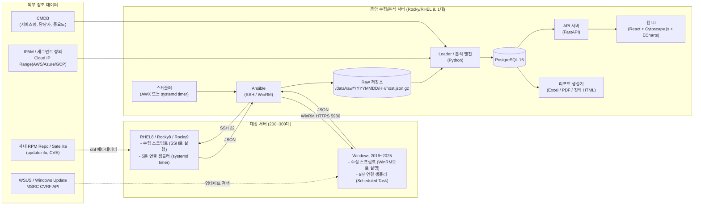
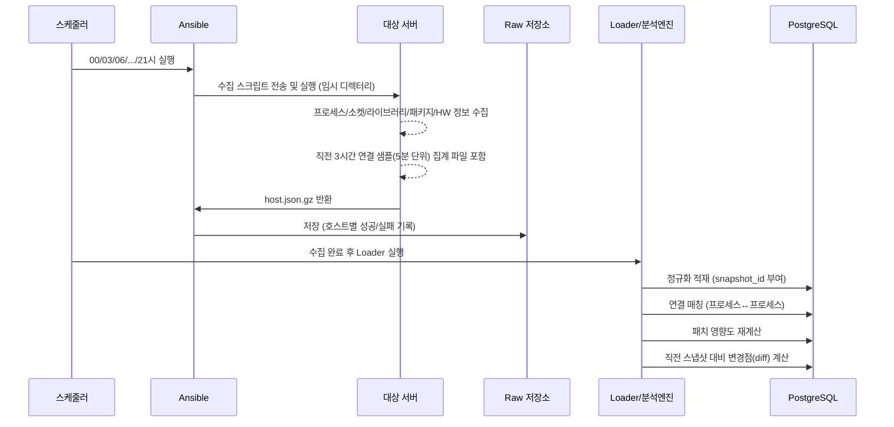
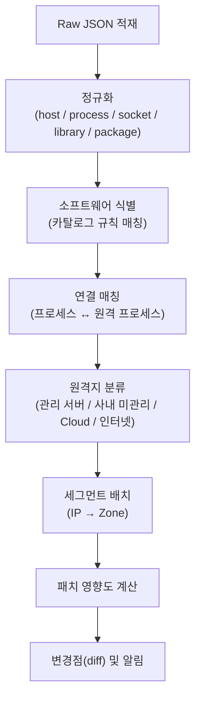
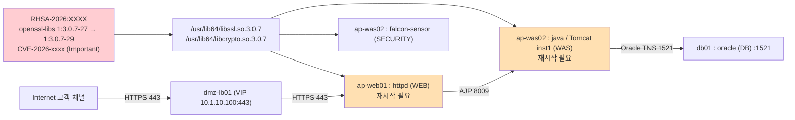
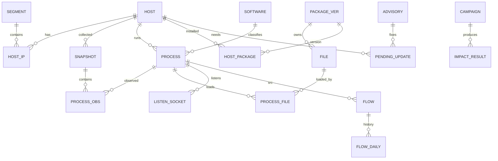

# IT 인프라 영향도 맵 (Infra Impact Map) 설계서

| 항목 | 내용 |
|---|---|
| 문서 버전 | v0.1 (초안) |
| 작성일 | 2026-10-26 |
| 대상 | AXA 보유 서버 약 200~300대 (RHEL 8, Rocky Linux 8/9, Windows Server 2016/2019/2022/2025) |
| 갱신 주기 | 전체 수집 3시간 주기, 네트워크 연결 샘플링 5분 주기 |
| 목적 | OS 패치 전 영향도 사전 파악, 프로세스 장애 시 주변 시스템 영향 범위(Blast Radius) 파악 |

---

## 목차

1. [개요 및 목표](#1-개요-및-목표)
2. [핵심 설계 원칙](#2-핵심-설계-원칙)
3. [전체 아키텍처](#3-전체-아키텍처)
4. [도구(Tool / Software) 선정](#4-도구tool--software-선정)
5. [Agentless vs Agent 방식 결정](#5-agentless-vs-agent-방식-결정)
6. [대상 서버별 사전 준비 사항 (설치 패키지 / 계정 / 방화벽)](#6-대상-서버별-사전-준비-사항)
7. [데이터 수집 상세 설계 (Linux)](#7-데이터-수집-상세-설계-linux)
8. [데이터 수집 상세 설계 (Windows)](#8-데이터-수집-상세-설계-windows)
9. [중앙 처리: 정규화 · 연결 매칭 · 네트워크 세그먼트](#9-중앙-처리-정규화--연결-매칭--네트워크-세그먼트)
10. [패치 영향도 분석 엔진](#10-패치-영향도-분석-엔진)
11. [데이터 모델 (DB 스키마)](#11-데이터-모델-db-스키마)
12. [결과물(시각화) 설계 — HTML인가, 웹 애플리케이션인가](#12-결과물시각화-설계)
13. [추가 제안 결과물](#13-추가-제안-결과물)
14. [운영 · 보안 고려사항](#14-운영--보안-고려사항)
15. [한계 및 보완 방안](#15-한계-및-보완-방안)
16. [단계별 구축 로드맵](#16-단계별-구축-로드맵)
17. [부록: 수집 스크립트 예시](#17-부록-수집-스크립트-예시)

---

## 1. 개요 및 목표

### 1.1 해결하려는 문제

- 보안 취약점(CVE) 대응으로 OS 패키지를 업데이트할 때, **어떤 서버의 어떤 프로세스가 영향을 받는지** 사전에 알 수 없다.
- 특정 프로세스(Daemon/Service)가 다운되면 **어떤 원격 서버/프로세스가 연쇄적으로 영향을 받는지** 알 수 없다.
- 시스템 간 통신이 **언제(주간/야간) 발생하는지** 근거가 없어, 서비스 중단 가능 시간대(Maintenance Window)를 정하기 어렵다.

### 1.2 최종 산출물이 답해야 하는 질문

| # | 질문 | 사용하는 데이터 |
|---|---|---|
| Q1 | 서버 A의 프로세스 X는 어떤 원격 서버의 어떤 프로세스와 몇 번 포트, 어떤 프로토콜로 통신하는가? | 소켓/연결 정보 + 원격 서버의 Listen 소켓 |
| Q2 | 서버 A에는 어떤 소프트웨어(보안, WEB/WAS, DB 등)가 동작하는가? | 프로세스 + 소프트웨어 카탈로그 |
| Q3 | 프로세스 X는 어떤 library를 로드하고, 그 library는 어떤 패키지에 속하는가? | `/proc/<pid>/maps` + RPM DB / Windows 모듈 정보 |
| Q4 | 이번 패치에서 업데이트되는 패키지 P는 어떤 프로세스에 영향을 주고, 어떤 위험(재시작/재부팅/ABI 변경)이 있는가? | 대기 중 업데이트(Advisory/CVE) × Q3 |
| Q5 | 최악의 경우 프로세스 X가 다운되면, 주변 어떤 시스템이 영향을 받는가? | Q1 그래프의 역방향 탐색 (Fan-in) |
| Q6 | 서버 A ↔ 외부(Cloud) 통신은 몇 시부터 몇 시까지 발생하는가? | 5분 샘플링 연결 이력의 시간대 히트맵 |

---

## 2. 핵심 설계 원칙

1. **대상 서버에 상주 Agent를 설치하지 않는다 (기본).** 중앙에서 SSH(Linux) / WinRM(Windows)으로 접속하여 OS 기본 명령만으로 수집한다.
2. **대상 서버에 새 패키지를 설치하지 않는다 (기본).** RHEL/Rocky의 `iproute(ss)`, `rpm`, `dnf`, `/usr/libexec/platform-python`, Windows의 PowerShell 5.1은 기본 설치되어 있다.
3. **"실제로 로드된" library 기준으로 판단한다.** `ldd` 같은 정적 분석보다 `/proc/<pid>/maps`(Linux), `Process.Modules`(Windows)로 **실행 중 메모리에 매핑된 파일**을 기준으로 한다. (dlopen으로 동적 로드되는 플러그인까지 포착 가능)
4. **연결은 양쪽 끝을 모두 수집해 "프로세스 ↔ 프로세스"로 매칭한다.** 관리 대상 서버끼리는 원격 측의 Listen 소켓 소유 프로세스까지 식별된다.
5. **수집(Raw) → 정규화(DB) → 분석(영향도) → 시각화를 분리한다.** 수집 스크립트가 바뀌어도 화면/분석 로직은 영향을 받지 않는다.
6. **시점(Snapshot) 이력을 보존한다.** 패치 전/후 비교, 통신 시간대 분석, 구성 변경 추적에 사용한다.

---

## 3. 전체 아키텍처

### 3.1 구성도



### 3.2 데이터 흐름 (3시간 주기)



### 3.3 규모 산정 (300대 기준)

| 항목 | 추정치 | 비고 |
|---|---|---|
| 서버당 프로세스 | 150~400개 | 커널 스레드 제외 |
| 서버당 로드된 고유 library 파일 | 1,000~3,000개 | |
| 서버당 프로세스-library 관계 | 10,000~40,000건 | |
| 전체 스냅샷 1회 적재량 | 약 300만~1,000만 행 | 관계 테이블 기준 |
| 서버당 Raw JSON(gzip) | 200KB~1MB | |
| 1회 전체 수집 소요 | 약 10~15분 | Ansible forks=30 기준 |

→ **중앙 서버 1대 (8 vCPU / 32GB RAM / 500GB 디스크)** 로 충분하다. 프로세스-library 관계는 "변경 시에만 새 행" 방식(11장)으로 저장해 증가량을 억제한다.

---

## 4. 도구(Tool / Software) 선정

### 4.1 선정 결과

| 영역 | 선정 도구 | 선정 이유 |
|---|---|---|
| 수집 오케스트레이션 | **Ansible (ansible-core 2.16+)**, `ansible.windows` 컬렉션, `pywinrm` | Agentless, Linux/Windows 동시 지원, 병렬 실행, 사내 표준으로 많이 사용 |
| 스케줄링/실행 이력 | **AWX** (또는 초기에는 systemd timer + cron) | 실행 이력/실패 호스트/자격증명 관리 GUI. 초기 PoC는 timer로 충분 |
| 자격증명 보관 | Ansible Vault (또는 사내 CyberArk 연동) | 수집 계정 비밀번호/키 보호 |
| Linux 수집 | `ss`, `/proc`, `rpm`, `dnf`, `systemctl`, `/usr/libexec/platform-python` | **모두 OS 기본 설치** |
| Windows 수집 | PowerShell 5.1 (`Get-NetTCPConnection`, `Get-Process`, CIM, Windows Update Agent API) | **모두 OS 기본 내장** |
| 저장소 | **PostgreSQL 16** | 스냅샷 이력, 시계열성 연결 데이터, 재귀 쿼리(WITH RECURSIVE)로 다단계 영향 탐색 가능. 운영 단순(DB 1종) |
| 분석/ETL | **Python 3.11+** (psycopg, pandas, ipaddress, networkx) | 연결 매칭, 영향도 그래프 계산 |
| API | **FastAPI** | 경량, OpenAPI 문서 자동 생성 |
| 웹 UI | **React + Cytoscape.js** (그래프), **ECharts** (히트맵/차트), **AG Grid** (표) | Cytoscape.js는 Compound Node(세그먼트 > 서버 > 프로세스) 표현과 대규모 그래프 레이아웃(fCoSE, ELK)에 강함 |
| 리포트 | openpyxl (Excel), WeasyPrint (PDF), 정적 HTML | CAB(변경심의) 제출용 |
| 인증 | AD/LDAP 연동 (또는 사내 SSO) | |
| (Phase 4) 성능 지표 | Prometheus + node_exporter / windows_exporter + Grafana | 성능 지표는 Agent 방식이 현실적 (16장 참조) |
| (선택) 단기 연결 정밀 포착 | Linux: `bcc-tools`(tcplife/tcpconnect, eBPF) / Windows: Sysmon(Event ID 3) | 5분 샘플링으로 놓치는 짧은 연결 보완 (5장) |

> **그래프 DB(Neo4j)에 대한 판단:** 영향도 탐색은 "패키지 → library → 프로세스 → 연결 → 원격 프로세스 → …" 형태로 깊이가 보통 3~5단계이며, 300대 규모에서는 PostgreSQL 재귀 쿼리 + Python(networkx) 메모리 그래프로 충분히 빠르다. DB를 2종 운영하는 부담을 피하기 위해 **PostgreSQL 단일 저장소를 권장**하며, 향후 탐색 요구가 복잡해지면 Neo4j(또는 PostgreSQL 확장 Apache AGE)를 읽기 전용 그래프 뷰로 추가하는 것을 고려한다.

### 4.2 상용 솔루션과 비교 (자체 구축을 권장하는 이유)

| 솔루션 | 장점 | 본 요구사항 대비 부족한 점 |
|---|---|---|
| ServiceNow Discovery / Service Mapping | CMDB 연계, 애플리케이션 의존성 맵 | 고가, **library → package → 패치 영향** 분석 기능 없음 |
| BMC Helix Discovery | Agentless, 의존성 맵 강력 | 고가, 패키지-라이브러리 수준 패치 영향 미지원 |
| Faddom, Device42 | Agentless 네트워크 의존성 맵 | 프로세스-라이브러리-패키지 연계 없음 |
| Dynatrace, Datadog NPM | 실시간 프로세스/네트워크 맵, 성능 지표 | Agent 필수, 서버당 과금, 패치 사전 영향 분석 미흡 |

→ 요구사항의 핵심인 **"패치 대상 패키지 → 해당 library를 로드한 프로세스 → 그 프로세스의 네트워크 의존 관계"** 를 한 번에 연결하는 기능은 상용 제품에서도 제공이 미흡하므로, **OS 기본 기능 기반 자체 구축**이 비용 대비 효과가 가장 크다.

---

## 5. Agentless vs Agent 방식 결정

### 5.1 결론: "Agentless 기본 + 경량 샘플러 + (선택) Agent"

| 계층 | 방식 | 대상 서버 변경 사항 | 수집 내용 |
|---|---|---|---|
| **L1. 정기 스냅샷 (필수)** | Agentless (SSH/WinRM으로 3시간마다 원격 실행) | 없음 (임시 파일 실행 후 삭제) | HW/OS 정보, 프로세스, Listen 소켓, 연결, 로드된 library, 패키지, 대기 중 업데이트 |
| **L2. 연결 샘플러 (필수 권장)** | 상주 데몬이 아닌 **5분 주기 스크립트** (Linux: systemd timer, Windows: 예약 작업) | 스크립트 파일 1개 + 타이머 등록 (패키지 설치 없음) | 5분마다 연결 스냅샷 → 고유 연결별 시간대 집계 |
| **L3. 정밀 연결 추적 (선택)** | Agent (eBPF `tcplife` / Sysmon) | 패키지 설치 필요 | 수 초 이내의 짧은 연결까지 PID와 함께 기록 |
| **L4. 성능 지표 (Phase 4)** | Agent (node_exporter / windows_exporter) | 패키지 설치 필요 | CPU/메모리/디스크/네트워크 사용률 |

### 5.2 L2 샘플러가 필요한 이유

3시간마다 1회 스냅샷만 찍으면 **그 순간 맺어져 있던 연결만** 보인다. 배치 작업, 야간 백업, Cloud 연동 API 호출처럼 **특정 시간대에만 발생하는 통신**은 거의 누락된다. 5분 샘플러는 상주 프로세스 없이 `ss`/`Get-NetTCPConnection`을 한 번 실행하고 종료하므로 부하가 무시할 수준(1회 0.1~0.5초)이며, 이를 통해 **요일 × 시간대 통신 히트맵**을 만들 수 있다. 이것이 "몇 시부터 몇 시까지 서비스 down이 가능한가"의 근거 데이터가 된다.

### 5.3 L3를 도입하는 경우

- 5분 이하 짧은 연결(예: 수 초짜리 REST 호출, DNS, NTP)이 업무상 중요한 서버 (예: 대외계, 결제 연동)
- 보안팀이 이미 Sysmon을 배포한 경우 → 추가 설치 없이 Windows 이벤트 로그(Event ID 3: Network connection)를 함께 수집
- Linux: `bcc-tools` 패키지(RHEL8/9, Rocky 기본 Repo 제공)의 `tcplife`는 연결 종료 시 PID/프로세스명/원격IP/포트/지속시간/송수신 바이트를 1줄로 남김 → systemd 서비스로 상시 실행하여 로그 파일로 기록

---

## 6. 대상 서버별 사전 준비 사항

### 6.1 공통

| 항목 | 내용 |
|---|---|
| 인벤토리 | 서버 목록(호스트명, IP, OS, 서비스명, 담당자, 중요도) — CMDB에서 CSV 추출 → Ansible 인벤토리 자동 생성 |
| 방화벽 | 중앙 수집 서버 → 대상: Linux TCP 22, Windows TCP 5986 (WinRM HTTPS) |
| 시간 동기화 | 모든 서버 NTP 동기화 (연결 시간대 분석 정확도) |
| 세그먼트 정의 | IP 대역(CIDR) ↔ 네트워크 존(DMZ, WEB, AP, DB, 관리망, 백업망 등) 매핑표 (IPAM 추출 또는 YAML 수기 작성) |

### 6.2 Linux (RHEL 8, Rocky 8, Rocky 9)

**설치 패키지: 없음 (기본 설치 패키지만 사용)**

| 사용 명령/파일 | 소속 패키지 | 기본 설치 여부 |
|---|---|---|
| `ss` | iproute | 기본 |
| `rpm`, `dnf` | rpm, dnf | 기본 |
| `/usr/libexec/platform-python` | platform-python (dnf 의존성) | 기본 |
| `systemctl` | systemd | 기본 |
| `lscpu`, `lsblk` | util-linux | 기본 |
| `dmidecode` | dmidecode | 대부분 기본 (없으면 `/sys/class/dmi/id` 사용) |
| `needs-restarting` (dnf 플러그인) | dnf-utils / yum-utils | **선택** — 패치 후 검증 시 유용, 없으면 `/proc/*/maps`의 `(deleted)` 표시로 대체 |

**수집 계정 설정**

```bash
# 1) 전용 계정 생성
useradd -m -s /bin/bash svc_infamap
mkdir -p /home/svc_infamap/.ssh && chmod 700 /home/svc_infamap/.ssh
# 중앙 서버의 공개키 등록 (from= 옵션으로 접속 IP 제한)
echo 'from="10.10.1.50" ssh-ed25519 AAAA... infamap-collector' > /home/svc_infamap/.ssh/authorized_keys
chmod 600 /home/svc_infamap/.ssh/authorized_keys
chown -R svc_infamap: /home/svc_infamap/.ssh

# 2) sudo 권한: 수집 스크립트만 root로 실행 허용 (다른 사용자 프로세스의 /proc/<pid>/maps, ss -p 조회에 root 필요)
cat > /etc/sudoers.d/svc_infamap <<'EOF'
svc_infamap ALL=(root) NOPASSWD: /opt/infamap/bin/collect.py, /opt/infamap/bin/sampler.py
Defaults:svc_infamap !requiretty
EOF
chmod 440 /etc/sudoers.d/svc_infamap
```

> 보안 심의상 sudo 범위를 최소화하기 위해 **스크립트를 고정 경로(/opt/infamap/bin)에 root 소유·755 권한으로 배포**하고 그 경로만 허용한다. 스크립트 변경은 Ansible 배포로만 수행한다.

**배포 파일 (Ansible이 최초 1회 배포)**

```
/opt/infamap/bin/collect.py          # 3시간 주기 스냅샷 수집 (Ansible이 원격 실행)
/opt/infamap/bin/sampler.py          # 5분 주기 연결 샘플러
/etc/systemd/system/infamap-sampler.service
/etc/systemd/system/infamap-sampler.timer   # OnCalendar=*:0/5
/var/lib/infamap/                    # 샘플 집계 파일 (conn-YYYYMMDD.json, 7일 보관)
```

### 6.3 Windows (2016, 2019, 2022, 2025)

**설치 패키지: 없음 (PowerShell 5.1, WinRM 기본 내장)**

| 항목 | 설정 내용 |
|---|---|
| WinRM | HTTPS 리스너(5986) 활성화, 사내 CA 인증서 바인딩 — GPO로 일괄 적용 권장 |
| 인증 | Kerberos (도메인 계정). 워크그룹 서버는 NTLM over HTTPS 또는 CredSSP 회피 |
| 수집 계정 | 도메인 서비스 계정 `svc_infamap` — 대상 서버 로컬 Administrators 그룹 (다른 사용자/서비스 프로세스의 모듈(DLL) 목록 조회에 관리자 권한 필요). 보안 정책상 필요 시 **JEA(Just Enough Administration)** 엔드포인트로 허용 명령 제한 |
| 배포 파일 | `C:\ProgramData\InfaMap\bin\collect.ps1`, `sampler.ps1` |
| 예약 작업 | `InfaMap-Sampler`: SYSTEM 계정, 5분 반복, `powershell.exe -NoProfile -ExecutionPolicy Bypass -File ...\sampler.ps1` |
| 샘플 저장 | `C:\ProgramData\InfaMap\data\conn-YYYYMMDD.json` (7일 보관) |
| (선택) Sysmon | 보안팀 표준 구성 사용 시 Event ID 3 수집 |

---

## 7. 데이터 수집 상세 설계 (Linux)

### 7.1 수집 항목 및 방법

| 구분 | 수집 항목 | 방법 (명령/소스) |
|---|---|---|
| 기본 정보 | 호스트명, OS 버전, 커널, 부팅 시각 | `/etc/os-release`, `uname -r`, `/proc/stat`(btime) |
| HW | CPU 모델/코어, 메모리, 디스크, 가상화 여부, 제조사/모델/시리얼 | `lscpu -J`, `/proc/meminfo`, `lsblk -J`, `systemd-detect-virt`, `/sys/class/dmi/id/*` |
| 네트워크 | 인터페이스/IP/MAC, 라우팅, DNS | `ip -j addr`, `ip -j route`, `/etc/resolv.conf`, `/etc/hosts` |
| 프로세스 | PID, PPID, 사용자, exe 경로, cmdline, 시작 시각, systemd unit, 컨테이너 여부 | `/proc/<pid>/{exe,cmdline,status,stat,cgroup}` |
| Listen 소켓 | 프로토콜, 바인드 IP, 포트, 소유 PID | `ss -H -tulnp` |
| 연결 | 프로토콜, 로컬 IP:포트, 원격 IP:포트, 상태, PID | `ss -H -tunap` (ESTABLISHED 및 UDP connected) |
| 로드된 library | 프로세스별 매핑된 `.so` 파일 경로, `(deleted)` 여부 | `/proc/<pid>/maps` (6번째 컬럼) |
| 실행 파일·library ↔ 패키지 | 파일 → 패키지명/버전 | `rpm -qa --qf '[%{FILENAMES}\t%{NAME}\t%{EPOCHNUM}:%{VERSION}-%{RELEASE}\t%{ARCH}\n]'` 1회 실행 후 사전 매핑 |
| 설치 패키지 | 전체 패키지 목록, 설치일, 벤더 | `rpm -qa --qf ...` |
| 대기 중 업데이트 | 업데이트 대상 패키지, 신규 버전, Advisory(RHSA/RLSA), 심각도, CVE | `dnf -q updateinfo list --updates --with-cve`, `dnf -q repoquery --upgrades --latest-limit=1` (**1일 1회**, 13장 참조) |
| 신규 버전 Provides | 업데이트될 패키지의 soname 변화 | `rpm -q --provides <pkg>` vs `dnf -q repoquery --provides <pkg-신규버전>` (로드된 library를 포함한 패키지만) |
| 커널 | 실행 커널 vs 설치된 최신 커널 | `uname -r` vs `rpm -q --last kernel` |
| 서비스 | systemd 서비스 목록/상태/활성화 여부 | `systemctl list-units --type=service --all --output=json` (RHEL9) / 일반 출력 파싱(RHEL8) |
| 컨테이너 | Podman/Docker 컨테이너 내부 소켓 | `nsenter -t <pid> -n ss ...` (컨테이너 존재 시만) |
| 연결 샘플 | 직전 기간 5분 샘플 집계 | `/var/lib/infamap/conn-*.json` |

### 7.2 프로세스 식별 키 (PID는 재시작 시 바뀌므로 사용 불가)

```
process_key = host_id + systemd_unit(있으면) + exe_path + cmdline_signature
cmdline_signature = cmdline에서 가변 값(PID, 임시 경로, 타임스탬프)을 제거하고
                    식별 인자(예: -Dcatalina.base=..., -ap "AppPool")만 남긴 해시
```

예: 동일 서버에 Tomcat 인스턴스가 3개(`java` 3개)여도 `catalina.base` 값으로 구분된다.

### 7.3 library 수집 시 주의 사항

- `/proc/<pid>/maps`에는 **심볼릭 링크가 해석된 실제 파일 경로**가 기록된다 (예: `/usr/lib64/libssl.so.1.1.1k`). RPM의 FILENAMES에도 실제 파일이 등록되어 있으므로 바로 매칭된다.
- 경로 끝에 ` (deleted)`가 붙어 있으면 **이미 패키지가 업데이트되었으나 프로세스가 재시작되지 않아 구버전을 사용 중**이라는 의미 → "재시작 필요" 상태로 표시한다.
- 스레드(`/proc/<pid>/task`)는 프로세스와 메모리를 공유하므로 수집하지 않는다.
- 커널 스레드(exe가 없는 프로세스)는 제외한다.
- 동일 실행 파일을 쓰는 다중 프로세스(예: httpd prefork 자식 수백 개)는 **부모 프로세스 기준으로 그룹화**하여 중복을 제거한다.
- Java/Python/Node 애플리케이션의 JAR·모듈은 OS 패키지가 아니므로 본 범위에서는 **런타임 패키지(java-17-openjdk, python3 등)와 OS 공용 library(openssl, glibc, zlib, nss, ca-certificates, tzdata)** 수준으로 판단한다. (15장 한계 참조)

### 7.4 연결 샘플러 (5분 주기) 집계 방식

5분마다 `ss -H -tunap`를 실행하고, 매번 원본을 저장하지 않고 **고유 연결 단위로 집계**한다.

```
집계 키 = (프로세스 exe + unit, 방향, 로컬 서비스 포트 또는 원격 서비스 포트, 원격 IP, 프로토콜)
값      = first_seen, last_seen, 관측 횟수, hour_bitmap(24비트: 해당 시간대에 1회 이상 관측되면 1)
```

- **방향 판정:** 로컬 포트가 Listen 소켓 목록에 있으면 `INBOUND`(내가 서버), 아니면 `OUTBOUND`(내가 클라이언트, 원격 포트가 서비스 포트)
- **Ephemeral 포트 제거:** 클라이언트 측 임시 포트(32768~60999 등)는 키에서 제외 → 동일 통신이 하나로 묶임
- 일자별 파일로 저장, 7일 보관 (중앙 DB에는 장기 보관)

---

## 8. 데이터 수집 상세 설계 (Windows)

### 8.1 수집 항목 및 방법

| 구분 | 수집 항목 | 방법 |
|---|---|---|
| 기본 정보 | OS 이름/빌드/UBR(누적 업데이트 수준), 부팅 시각, 도메인 | `Get-CimInstance Win32_OperatingSystem`, 레지스트리 `HKLM\SOFTWARE\Microsoft\Windows NT\CurrentVersion` (UBR) |
| HW | CPU, 메모리, 디스크, 제조사/모델, 가상화 | `Win32_Processor`, `Win32_ComputerSystem`, `Win32_LogicalDisk`, `Win32_BIOS` |
| 네트워크 | NIC/IP/게이트웨이/DNS | `Get-NetIPConfiguration`, `Get-NetIPAddress` |
| 프로세스 | PID, 부모 PID, 사용자, 경로, CommandLine, 시작 시각 | `Get-CimInstance Win32_Process` |
| 서비스 ↔ PID | 서비스명, 표시명, 시작 유형, PID (svchost 공유 서비스 포함) | `Get-CimInstance Win32_Service` |
| Listen 소켓 | 포트, 바인드 IP, PID | `Get-NetTCPConnection -State Listen`, `Get-NetUDPEndpoint` |
| 연결 | 로컬/원격 IP:포트, 상태, PID | `Get-NetTCPConnection -State Established` |
| 로드된 DLL | 프로세스별 모듈 경로, FileVersion, Company, Product | `(Get-Process -Id $pid).Modules` → `FileName`, `FileVersionInfo` |
| 설치 소프트웨어 | 제품명, 버전, 제조사, 설치 경로 | 레지스트리 `HKLM\...\Uninstall`, `HKLM\WOW6432Node\...\Uninstall` (**`Win32_Product` 사용 금지** — MSI 자체 복구를 유발함) |
| 설치된 업데이트 | KB 목록, 설치일 | `Get-HotFix`, 레지스트리/DISM 패키지 목록 |
| 대기 중 업데이트 | KB, 제목, 분류, 심각도, CVE, 재부팅 필요 여부 | Ansible `ansible.windows.win_updates` (`state: searched`) — WSUS/WU 연동 (**1일 1회**) |
| IIS (해당 시) | 사이트, 바인딩, App Pool ↔ w3wp PID | `Get-IISSite`, `appcmd list wp` |
| 역할/기능 | 설치된 Windows Role/Feature | `Get-WindowsFeature` |
| 연결 샘플 | 5분 샘플 집계 | `C:\ProgramData\InfaMap\data\conn-*.json` |

### 8.2 Windows에서의 "library → package" 개념 매핑

Windows에는 RPM 같은 파일-패키지 DB가 없으므로 다음 규칙으로 소속을 판정한다.

| DLL 위치 | 소속 판정 | 패치 영향 판정 방법 |
|---|---|---|
| `C:\Windows\System32`, `SysWOW64`, `WinSxS` | **Windows OS 컴포넌트** (누적 업데이트 CU에 포함) | 대기 중 KB의 **File Information CSV**(Microsoft가 KB마다 공개하는 변경 파일 목록·버전)와 DLL 파일명·버전 비교 |
| `C:\Windows\Microsoft.NET\` | **.NET Framework** | .NET 누적 업데이트 KB 해당 여부 |
| `C:\Program Files\<제품>\` 등 | **설치 소프트웨어** (Uninstall 레지스트리의 InstallLocation 경로 매칭 + FileVersionInfo의 ProductName/CompanyName) | 해당 제품의 패치(예: SQL Server CU) 대상 여부 |

> **현실적 판단:** Windows 월간 누적 업데이트는 **사실상 항상 재부팅을 요구**하므로, Windows 서버의 핵심 영향은 "서버 전체 재부팅 → 해당 서버의 모든 서비스 중단"이다. 따라서 Windows는 (1) **재부팅 시 영향 받는 주변 시스템(Blast Radius)**, (2) **재부팅 가능한 시간대(통신 히트맵)**, (3) **.NET/SQL Server/IIS 등 특정 컴포넌트 업데이트로 인한 애플리케이션 호환성 리스크**를 중심으로 제공한다. DLL 단위 매칭은 "어떤 서비스가 변경된 OS 컴포넌트를 사용하는가"를 보여주는 보조 정보로 활용한다.

### 8.3 Windows 수집 시 주의 사항

- **보호 프로세스(PPL)** — 백신/EDR(예: Defender, CrowdStrike, AhnLab V3 등)은 관리자 권한으로도 모듈 조회가 거부된다. 예외 처리 후 "모듈 조회 불가"로 표시하고, 소프트웨어 카탈로그로 식별한다.
- `svchost.exe` 하나에 여러 서비스가 묶여 있으므로 **PID → 서비스 목록**으로 표시한다.
- IIS `w3wp.exe`는 CommandLine의 `-ap "<AppPool명>"`으로 인스턴스를 구분한다.
- 32비트 프로세스의 모듈도 64비트 PowerShell에서 조회 가능하나 일부 누락될 수 있으므로, 누락 시 경고 표시한다.

---

## 9. 중앙 처리: 정규화 · 연결 매칭 · 네트워크 세그먼트

### 9.1 처리 단계



### 9.2 소프트웨어 카탈로그 (프로세스 → 소프트웨어 분류)

YAML로 관리하며, 운영하면서 지속적으로 보강한다. 미분류 프로세스는 화면에 "미분류"로 노출하여 담당자가 등록하도록 한다.

```yaml
# catalog/software.yaml (예시)
- name: Apache HTTP Server
  category: WEB
  match: { exe: ["/usr/sbin/httpd"] }
- name: Nginx
  category: WEB
  match: { exe: ["*/nginx"] }
- name: WebtoB
  category: WEB
  match: { exe: ["*/wsm", "*/htl", "*/hth"] }
- name: Apache Tomcat
  category: WAS
  match: { exe: ["*/java"], cmdline_regex: "org\\.apache\\.catalina\\.startup\\.Bootstrap" }
  instance_from: "-Dcatalina\\.base=(\\S+)"
- name: JEUS
  category: WAS
  match: { exe: ["*/java"], cmdline_regex: "jeus\\." }
- name: Oracle Database
  category: DB
  match: { cmdline_regex: "^ora_pmon_(\\w+)" }
  instance_from: "^ora_pmon_(\\w+)"
- name: Tibero
  category: DB
  match: { exe: ["*/tbsvr"] }
- name: PostgreSQL
  category: DB
  match: { exe: ["*/postgres", "*/postmaster"] }
- name: MySQL / MariaDB
  category: DB
  match: { exe: ["*/mysqld", "*/mariadbd"] }
- name: Microsoft SQL Server
  category: DB
  match: { exe: ["*\\sqlservr.exe"] }
- name: IIS Worker
  category: WEB
  match: { exe: ["*\\w3wp.exe"] }
  instance_from: "-ap \"([^\"]+)\""
- name: CrowdStrike Falcon
  category: SECURITY
  match: { exe: ["/opt/CrowdStrike/falcon-sensor", "*\\CSFalconService.exe"] }
- name: Trend Micro Deep Security
  category: SECURITY
  match: { exe: ["*/ds_agent", "*\\dsa.exe"] }
- name: Veritas NetBackup Client
  category: BACKUP
  match: { exe: ["*/bpcd", "*/vnetd", "*\\bpinetd.exe"] }
# 분류: WEB, WAS, DB, SECURITY, MONITORING, BACKUP, MIDDLEWARE(MQ 등), BATCH, OS_CORE, ETC
```

### 9.3 연결 매칭 알고리즘 (프로세스 ↔ 원격 프로세스)

```
입력: 모든 서버의 OUTBOUND 연결 (src_process, remote_ip, remote_port, proto)
      모든 서버의 LISTEN 소켓   (dst_host, bind_ip, port, proto, dst_process)

1. remote_ip → 관리 대상 서버 조회 (host_ip 테이블, 보조 IP/VIP 포함)
2-a. 관리 대상 서버이면:
      해당 서버의 LISTEN(port, proto) 중 bind_ip가 remote_ip 또는 0.0.0.0/:: 인 소켓의 소유 프로세스
      → edge(src_process → dst_process, port, proto)    ※ 양방향 확정
2-b. 상대 서버 쪽 INBOUND 연결 기록으로 교차 검증 (양쪽 모두 관측 시 confidence=HIGH)
3. 관리 대상이 아니면 원격지 분류:
      - VIP/L4 매핑표에 있으면 → VIP 뒤의 실서버 그룹으로 연결 (수기/LB 설정 추출)
      - 사내 세그먼트 CIDR에 포함 → "사내 미관리 서버" 노드 (역DNS명 표시)
      - Cloud IP Range(AWS ip-ranges.json, Azure Service Tags, GCP cloud.json, M365 endpoints)에 포함
        → "Cloud: AWS ap-northeast-2 / S3" 처럼 서비스 단위 노드
      - 그 외 → "Internet" 노드
4. 동일 (src_process, dst_process, port, proto)는 하나의 edge로 병합하고
   관측 이력(일자별 hour_bitmap)을 edge 속성으로 누적
```

**프로토콜 표시:** L4(TCP/UDP) + 포트 기반 L7 추정(443→HTTPS, 1521→Oracle TNS, 1433→MSSQL, 3306→MySQL, 5432→PostgreSQL, 8009→AJP, 389/636→LDAP(S), 445→SMB, 2049→NFS, 1556/13724→NetBackup 등). 서비스 포트 사전은 `catalog/ports.yaml`로 관리하며, 수신 프로세스가 확인되면 프로세스 기반 표시(예: "sqlservr.exe:1433")가 우선한다.

### 9.4 네트워크 세그먼트 배치

```yaml
# catalog/segments.yaml (예시)
- zone: DMZ
  cidrs: ["10.1.10.0/24"]
  color: "#E57373"
- zone: Internal-WEB
  cidrs: ["10.1.20.0/24"]
- zone: Internal-AP
  cidrs: ["10.1.30.0/23"]
- zone: Internal-DB
  cidrs: ["10.1.40.0/24"]
- zone: Management
  cidrs: ["10.1.250.0/24"]
- zone: Backup
  cidrs: ["10.1.251.0/24"]
- zone: Cloud
  source: cloud_ip_ranges   # 외부 공개 IP 대역 파일 자동 갱신 (주 1회)
```

- 서버의 **업무용 IP(기본 게이트웨이를 가진 NIC)** 로 소속 Zone을 결정하고, 백업망·관리망 NIC는 보조 정보로 표시한다.
- 세그먼트 정의에 없는 IP 대역이 관측되면 "미정의 대역"으로 리포트하여 정의표를 보강한다.

### 9.5 HTTP Proxy / NAT 주의

- Cloud 연동이 **Forward Proxy를 경유**하면 서버 입장에서는 원격지가 Proxy로만 보인다. → Proxy 서버를 관리 대상에 포함하고, 가능하면 **Proxy 접근 로그(목적지 도메인)** 를 별도 수집하여 "서버 → Proxy → 최종 목적지(도메인)"를 연결한다.
- 방화벽 NAT로 IP가 변환되는 구간은 NAT 매핑표(방화벽 정책 추출)를 `catalog/nat.yaml`로 관리한다.

---

## 10. 패치 영향도 분석 엔진

### 10.1 핵심 개념: 패치는 언제 프로세스에 영향을 주는가

| 시점 | 실제로 일어나는 일 | 영향 |
|---|---|---|
| 패키지 업데이트 직후 | 디스크의 library 파일만 교체됨. **실행 중인 프로세스는 메모리에 로드된 구버전을 계속 사용** (`(deleted)` 상태) | 즉시 장애는 드묾. 단, **실행 중 dlopen으로 새로 로드하는 플러그인**(PAM, NSS, OpenSSL engine/provider, Apache 모듈 등)은 구/신 버전 혼재로 오류 가능 |
| 서비스 재시작 시 | 신버전 library 로드 | **ABI/동작 변경 시 기동 실패 또는 기능 오류** 가능 — 실제 리스크 지점 |
| 재부팅 시 (kernel, glibc, systemd 등) | 서버 전체 재기동 | 해당 서버의 모든 서비스 중단 → 주변 시스템 영향 |
| 패치 후 미재시작 방치 | 보안 패치가 **실제로는 적용되지 않은 상태** | 취약점 잔존 (컴플라이언스 이슈) |

→ 따라서 영향도 엔진은 **"패치 후 반드시 재시작해야 하는 프로세스 목록"** 과 **"그 재시작/다운 시 영향 받는 주변 시스템"** 을 산출하는 것이 핵심이다.

### 10.2 입력 데이터

1. **패치 대상 정의 (Patch Campaign)**: 예) "2026년 11월 정기 패치" = 특정 Repo 스냅샷(Satellite Content View 또는 날짜 고정 미러) 기준 업데이트 전체, 또는 특정 Advisory/CVE 목록(긴급 패치)
2. 서버별 대기 중 업데이트 (패키지, 현재 버전 → 신규 버전, Advisory, CVE, 심각도)
3. 서버별 프로세스 ↔ 로드된 파일 ↔ 소속 패키지
4. 신규 버전의 Provides(soname) 목록
5. 연결 그래프 (9장)
6. CMDB 서비스 중요도

### 10.3 알고리즘

```
for 서버 S in 캠페인 대상:
  for 업데이트 패키지 P (현재 vX → 신규 vY) in S.pending:
     1) 재부팅 필요 여부
        P ∈ {kernel*, glibc, linux-firmware, systemd, dbus*, microcode_ctl, ...}  → REBOOT
        (dnf needs-restarting -r 의 판단 목록과 동일하게 관리)
     2) 직접 영향 프로세스
        affected = { proc | proc.loaded_files ∩ files(P) ≠ ∅ }      # library를 로드한 프로세스
                 ∪ { proc | proc.exe ∈ files(P) }                   # P가 프로세스의 실행 파일 자체
     3) ABI 변경 검사
        removed_sonames = provides(P,vX) − provides(P,vY)          # 예: libfoo.so.1 제거
        if affected 중 removed_soname을 사용하는 프로세스 존재 → ABI_BREAK (HIGH)
     4) 설정 파일 변경 가능성
        P에 %config(noreplace) 파일 존재 → ".rpmnew 생성 가능, 설정 수동 병합 필요" 안내
     5) 위험도 산정 (아래 표)
  서버 단위 결과 = max(패키지별 위험도), 재시작 대상 서비스 목록, 재부팅 여부

for 영향 프로세스 proc (재시작/다운 가정):
   upstream   = proc로 들어오는 INBOUND edge의 출발 프로세스들 (재귀, 최대 깊이 N)   # 나를 호출하는 쪽
   downstream = proc가 나가는 OUTBOUND edge의 목적지들 (1단계)                    # 내가 의존하는 쪽
   Blast Radius = upstream 트리 (서버 수, 서비스 수, Zone 분포)
   다운 가능 시간대 = upstream edge들의 hour_bitmap OR 연산 → 통신이 없는 시간대
```

### 10.4 위험도 기준

| 등급 | 조건 | 조치 권고 |
|---|---|---|
| **CRITICAL** | ABI 변경(soname 제거) 패키지를 로드한 프로세스가 업무 서비스 / 재부팅 필요 + Blast Radius에 중요도 '상' 서비스 포함 | 사전 테스트 서버 검증 필수, 다운 가능 시간대 내 작업, 롤백 계획 |
| **HIGH** | 업무 프로세스(WEB/WAS/DB)가 로드한 library 업데이트 → 서비스 재시작 필요 / 재부팅 필요 | 재시작 대상 서비스 목록 사전 공유, 연관 시스템 담당자 통보 |
| **MEDIUM** | 보안/모니터링/백업 Agent 등 비업무 프로세스만 영향 / dlopen 플러그인 계열(pam, nss, openssl provider) 업데이트 | 재시작 후 Agent 정상 동작 확인 |
| **LOW** | 실행 중인 프로세스가 로드하지 않은 패키지 (CLI 도구, 문서 등) | 일반 패치 절차 |

**우선순위 점수 (같은 등급 내 정렬용)**

```
Impact Score = 위험도 가중치(CRITICAL 4 / HIGH 3 / MEDIUM 2 / LOW 1)
             × 서비스 중요도 가중치(상 3 / 중 2 / 하 1)
             × log2(1 + Blast Radius 서버 수)
```

### 10.5 예시 결과 (openssl 보안 업데이트)



리포트 문구 예:

> **ap-web01 / httpd** — `openssl-libs` 업데이트로 `libssl.so.3` 교체. 업데이트 후 **httpd 재시작 필요** (재시작 전까지 구버전 사용 → 취약점 잔존). 재시작 중 **dmz-lb01 경유 고객 채널 HTTPS 요청 영향**. 최근 28일 관측 기준 해당 경로 통신 **최저 시간대: 03:00~05:00 (관측률 2%)**. soname 변경 없음 → ABI 리스크 낮음. 위험도 **HIGH**.

### 10.6 패치 후 검증 (사후 비교)

패치 작업 직후 **수동 트리거로 즉시 수집**을 실행하고, 패치 전 스냅샷과 비교한다.

| 비교 항목 | 이상 판정 |
|---|---|
| 프로세스 | 패치 전 존재하던 업무 프로세스(process_key)가 사라짐 |
| Listen 포트 | 패치 전 열려 있던 포트가 닫힘 |
| 연결 | 패치 전 상시 관측되던 주요 연결(INBOUND/OUTBOUND)이 사라짐 |
| 재시작 누락 | 여전히 `(deleted)` library를 사용하는 프로세스 존재 (Linux) / 재부팅 대기 상태 (Windows) |
| 커널 | 설치된 최신 커널 ≠ 실행 중 커널 |
| 버전 | 업데이트 대상 패키지/KB가 실제로 반영되었는지 |

---

## 11. 데이터 모델 (DB 스키마)

### 11.1 ERD



### 11.2 주요 테이블 (요약 DDL)

```sql
CREATE TABLE host (
  host_id      serial PRIMARY KEY,
  hostname     text UNIQUE NOT NULL,
  os_family    text,            -- RHEL / ROCKY / WINDOWS
  os_version   text,            -- 8.10, 9.4, 2019 ...
  kernel       text,            -- 4.18.0-553..., 10.0.17763.6414
  cpu_model    text, cpu_cores int, mem_mb int,
  virt         text, vendor text, model text, serial text,
  service_name text, owner text, criticality text,  -- CMDB 연동
  last_boot    timestamptz, last_seen timestamptz
);

CREATE TABLE segment (segment_id serial PRIMARY KEY, zone text, cidr cidr, color text);
CREATE TABLE host_ip (host_id int REFERENCES host, ip inet, iface text, is_primary bool, is_vip bool);

CREATE TABLE snapshot (snapshot_id bigserial PRIMARY KEY, host_id int REFERENCES host,
                       collected_at timestamptz, status text, raw_path text);

-- 프로세스: process_key 기준 1행 (PID와 무관한 논리적 프로세스)
CREATE TABLE process (
  process_id   bigserial PRIMARY KEY,
  host_id      int REFERENCES host,
  process_key  text,             -- 7.2 참조
  exe_path     text, unit_or_service text, run_user text,
  software_id  int REFERENCES software, instance_name text,
  first_seen   timestamptz, last_seen timestamptz,
  UNIQUE (host_id, process_key)
);
CREATE TABLE process_obs (snapshot_id bigint, process_id bigint, pid int, start_time timestamptz,
                          cmdline text, rss_kb bigint);

CREATE TABLE package_ver (pkg_id bigserial PRIMARY KEY, name text, evr text, arch text, os_family text,
                          UNIQUE (name, evr, arch, os_family));
CREATE TABLE file (file_id bigserial PRIMARY KEY, path text, pkg_id bigint REFERENCES package_ver,
                   file_version text);  -- Windows는 FileVersion
-- 변경 시에만 행 추가 (valid_from ~ valid_to) → 저장량 억제
CREATE TABLE process_file (process_id bigint, file_id bigint, is_deleted bool,
                           valid_from timestamptz, valid_to timestamptz);

CREATE TABLE pending_update (host_id int, pkg_name text, current_evr text, new_evr text,
                             advisory_id text, severity text, cves text[], reboot_required bool,
                             removed_sonames text[], checked_at timestamptz);

CREATE TABLE listen_socket (host_id int, process_id bigint, proto text, bind_ip inet, port int,
                            first_seen timestamptz, last_seen timestamptz);

-- 프로세스 간 통신 (매칭 결과)
CREATE TABLE flow (
  flow_id      bigserial PRIMARY KEY,
  src_process_id bigint,                 -- NULL 가능 (미관리 출발지)
  dst_process_id bigint,                 -- NULL 가능 (미관리 목적지)
  src_ip inet, dst_ip inet, dst_port int, proto text, l7_guess text,
  remote_class text,                     -- MANAGED / INTERNAL_UNMANAGED / CLOUD / INTERNET
  remote_label text,                     -- 예: "AWS ap-northeast-2 S3"
  confidence   text,                     -- HIGH(양측 관측) / MEDIUM(한쪽) 
  first_seen timestamptz, last_seen timestamptz
);
CREATE TABLE flow_daily (flow_id bigint, day date, hour_bitmap int, sample_count int,
                         PRIMARY KEY (flow_id, day));

CREATE TABLE campaign (campaign_id serial PRIMARY KEY, name text, scope jsonb, created_at timestamptz);
CREATE TABLE impact_result (campaign_id int, host_id int, process_id bigint, pkg_name text,
                            risk_level text, reason text, needs_restart bool, needs_reboot bool,
                            blast_radius jsonb, quiet_hours int[], score numeric);
```

### 11.3 영향 범위 탐색 쿼리 예시 (프로세스 다운 시 상위 의존 시스템)

```sql
WITH RECURSIVE upstream AS (
  SELECT f.src_process_id AS pid, 1 AS depth
    FROM flow f WHERE f.dst_process_id = :target_process_id
  UNION
  SELECT f.src_process_id, u.depth + 1
    FROM flow f JOIN upstream u ON f.dst_process_id = u.pid
   WHERE u.depth < 4 AND f.src_process_id IS NOT NULL
)
SELECT h.hostname, p.exe_path, s.name AS software, min(u.depth) AS depth
  FROM upstream u JOIN process p ON p.process_id = u.pid
  JOIN host h ON h.host_id = p.host_id LEFT JOIN software s ON s.software_id = p.software_id
 GROUP BY 1,2,3 ORDER BY depth;
```

### 11.4 데이터 보관 정책

| 데이터 | 보관 기간 |
|---|---|
| Raw JSON | 30일 (gzip) |
| 스냅샷 단위 상세 (process_obs) | 90일 |
| process, flow, process_file (이력형) | 2년 |
| flow_daily (시간대 히트맵) | 1년 |
| campaign / impact_result | 영구 (변경 관리 근거) |

---

## 12. 결과물(시각화) 설계

### 12.1 "HTML로 작성해야 하는가?"에 대한 답

| 방식 | 장점 | 단점 | 권장 용도 |
|---|---|---|---|
| **정적 HTML** (Python이 서버별 HTML 생성, 그래프 JS 내장) | 웹 서버/DB 불필요, 파일 공유 쉬움, 오프라인 열람 | 300대 × 이력 → 파일 폭증, **검색·What-if 시뮬레이션·이력 비교 불가**, 서버 간 이동(드릴다운) 제한 | **PoC(1단계)**, CAB 제출용 스냅샷 첨부 |
| **웹 애플리케이션** (DB + API + SPA) | 검색, 클릭 드릴다운, 패치 시뮬레이션, 기간 선택, 권한 관리, 이력 비교 | 구축 공수 | **운영(권장)** |
| Grafana 대시보드 | 빠른 구축, 성능 지표와 통합 쉬움 | 그래프(Node Graph) 표현력 제한, 서버→프로세스→library 다단계 드릴다운 부적합 | Phase 4 성능 지표 |

→ **권장안: 운영은 "웹 애플리케이션", PoC와 보고용은 "정적 HTML/Excel/PDF 내보내기".** 두 방식 모두 같은 API/JSON을 사용하도록 설계하면 PoC 산출물을 그대로 웹 UI로 발전시킬 수 있다.

### 12.2 화면 구성

```
[상단] 검색(호스트/IP/프로세스/패키지/CVE)  | 기준 시점 선택 | 캠페인 선택(패치 시뮬레이션 ON/OFF)

화면 1. 전체 인프라 맵 (Zone 뷰)
 ┌─────────────── DMZ ───────────────┐   ┌──── Internal-AP ────┐   ┌─ Internal-DB ─┐
 │  [dmz-lb01] [dmz-web01] [dmz-web02]│══▶│ [ap-was01][ap-was02]│══▶│ [db01] [db02] │
 └────────────────────────────────────┘   └─────────────────────┘   └───────────────┘
        ▲                                         │
   [Internet]                               ┌─ Cloud ─┐
                                            │ AWS S3  │  (선 굵기 = 연결 수, 색 = 위험도)
                                            └─────────┘
 - Zone은 Compound Node, 서버 간 선은 프로세스 연결을 집계한 것
 - 패치 시뮬레이션 ON: 영향 서버 빨강/주황, Blast Radius 하이라이트

화면 2. 서버 상세 (서버 클릭 시)
 ┌ 기본 정보 ───────────────────────────────────────────────────────────┐
 │ ap-was02 | Rocky 9.4 | Kernel 5.14.0-427 (최신 설치 커널: 5.14.0-503 ⚠ 재부팅 필요) │
 │ CPU Xeon Gold 6338 16C | Mem 64GB | IP 10.1.30.12 (Internal-AP) | VMware │
 │ 서비스: 보험청약 WAS | 담당: 홍길동 | 중요도: 상 | 대기 업데이트 42건 (Important 5) │
 └──────────────────────────────────────────────────────────────────────┘
 ┌ 프로세스 · 통신 맵 ──────────────────────────────────────────────────┐
 │ [호출하는 쪽 INBOUND]        [이 서버의 프로세스]       [호출받는 쪽 OUTBOUND]│
 │ dmz-web01:httpd ──AJP 8009──▶ (WAS) Tomcat inst1 ──TNS 1521──▶ db01:oracle   │
 │ dmz-web02:httpd ──AJP 8009──▶                    ──HTTPS 443──▶ AWS API GW   │
 │                               (SEC) falcon-sensor ──443──▶ CrowdStrike Cloud │
 │ mgmt-zbx01 ──10050──────────▶ (MON) zabbix_agentd                           │
 │                               (BAK) bpcd ◀──1556── nbu-master01             │
 └──────────────────────────────────────────────────────────────────────┘
 탭: [프로세스 목록] [Listen 포트] [설치 패키지] [대기 업데이트] [통신 시간대] [변경 이력]

화면 3. 프로세스 상세 (프로세스 클릭 시)
 Tomcat inst1 (java, PID 2314, user tomcat, unit tomcat@inst1.service)
 ├─ java-17-openjdk-headless 17.0.12 → 17.0.13 ⬆ (RLSA-2026:xxxx, Important)  [재시작 필요]
 │    └─ /usr/lib/jvm/.../libjvm.so, libnet.so ...
 ├─ openssl-libs 3.0.7-27 → 3.0.7-29 ⬆ (CVE-2026-xxxx)        [재시작 필요]
 │    └─ /usr/lib64/libssl.so.3.0.7, libcrypto.so.3.0.7
 ├─ glibc 2.34-100 → 2.34-125 ⬆                                [재부팅 권장]
 └─ zlib 1.2.11-40 (변경 없음)
 → "이 프로세스 다운 시 영향": Blast Radius 그래프 + 영향 서버 목록 + 다운 가능 시간대

화면 4. 패치 캠페인 (CVE / Advisory / 패키지 기준)
 - 입력: CVE-2026-xxxx 또는 "11월 정기패치"
 - 결과: 위험도별 서버/프로세스 목록, 재시작 대상 서비스, 재부팅 대상 서버, 권장 작업 순서
 - 내보내기: Excel(작업 체크리스트), PDF(CAB 제출), 정적 HTML(서버별 상세)

화면 5. 통신 시간대 히트맵 (요일 × 시간)
          00 01 02 03 04 05 06 07 08 09 10 11 12 ... 23
   월     ░  ░  ░  ░  ░  ░  ▒  ▓  █  █  █  █  █      ░
   ...
 - flow 단위 / 서버 단위 / Zone 간 / Cloud 연계 단위로 선택
 - "최근 28일 기준 통신 미관측 시간대: 평일 01:00~05:00" 문구 자동 생성
```

### 12.3 그래프 표현 규칙

| 요소 | 표현 |
|---|---|
| Zone | 배경 박스(Compound Node), 색상은 segments.yaml |
| 서버 | 노드, 아이콘으로 OS 구분 (RHEL/Rocky/Windows), 테두리 색 = 패치 위험도 |
| 프로세스 | 서버 내부 하위 노드, 아이콘으로 분류 (WEB/WAS/DB/SECURITY/MON/BACKUP) |
| 연결 | 화살표(클라이언트 → 서버), 라벨 = `프로토콜/포트`, 굵기 = 관측 빈도, 점선 = 한쪽만 관측(confidence MEDIUM) |
| 외부 | Cloud(공급자별 아이콘), Internet, 사내 미관리 서버(회색) |
| 레이아웃 | 전체 맵: Zone을 좌→우(외부→DMZ→AP→DB) 고정 배치 + fCoSE, 서버 상세: ELK layered(Inbound 좌, Outbound 우) |

---

## 13. 추가 제안 결과물

| # | 결과물 | 내용 | 활용 |
|---|---|---|---|
| 1 | **패치 사전 영향도 리포트** (Excel/PDF) | 캠페인 단위: 서버별 위험도, 재시작 서비스, 재부팅 여부, Blast Radius, 권장 시간대 | CAB(변경심의) 근거, 작업 체크리스트 |
| 2 | **패치 사후 검증 리포트** | 10.6 항목 비교 결과 (사라진 프로세스/포트/연결, 재시작 누락) | 작업 완료 확인, 장애 조기 발견 |
| 3 | **서비스 중단 가능 시간대 근거 리포트** | 서버/서비스/Cloud 연계별 요일×시간 통신 관측률 | 작업 시간 협의 근거 |
| 4 | **재시작 누락(Stale Library) 현황** | `(deleted)` library 사용 프로세스, 커널 불일치 서버 | 보안 패치 실효성 점검 (컴플라이언스) |
| 5 | **미승인/미정의 통신 탐지** | 신규 출현 외부 IP, 미정의 대역, Internet 직접 통신 | 보안팀 공유, 방화벽 정책 정합성 점검 |
| 6 | **변경 이력 타임라인** | 신규/사라진 프로세스, 포트, 연결, 패키지 버전 변화 | 장애 원인 분석 ("어제와 무엇이 달라졌나") |
| 7 | **EOS/EOL 현황** | OS·주요 소프트웨어 지원 종료 일정 (예: **Windows Server 2016 연장 지원 종료 2027-01-12**) | 업그레이드 계획 |
| 8 | **SPOF(단일 장애점) 리포트** | Fan-in이 큰데 이중화되지 않은 프로세스/서버 | 아키텍처 개선 |
| 9 | **방화벽 정책 대비 실제 통신 비교** (선택) | 정책은 있으나 미사용 / 사용되나 정책 근거 불명 | 방화벽 정책 정리 |

---

## 14. 운영 · 보안 고려사항

### 14.1 수집 스케줄

| 작업 | 주기 | 비고 |
|---|---|---|
| 전체 스냅샷 수집 | 3시간 (00, 03, 06, 09, 12, 15, 18, 21시) | 서버 간 시차를 줄이기 위해 forks 30~50으로 병렬 실행 |
| 연결 샘플러 | 5분 (대상 서버 로컬 실행) | 전체 수집 시 함께 회수 |
| 대기 업데이트 조회 (`dnf updateinfo` / WU 검색) | 1일 1회 (예: 02시) | 300대가 동시에 Repo 메타데이터를 받지 않도록 분산. 정기 패치 캠페인 확정 시 수동 실행 |
| Cloud IP Range / MSRC 데이터 갱신 | 주 1회 | 중앙 서버에서만 외부 접속 (또는 Proxy 경유) |
| 즉시 수집 (패치 전/후) | 수동 트리거 | AWX 템플릿 또는 웹 UI 버튼 |

### 14.2 대상 서버 부하

- 스냅샷 수집: 서버당 CPU 1코어 기준 5~30초, 메모리 50MB 미만. `nice -n 19`, `ionice -c3`로 실행
- 샘플러: 1회 0.1~0.5초
- 대기 업데이트 조회: Repo 메타데이터 다운로드가 가장 무거움 → 1일 1회로 제한, `dnf makecache`는 사내 Repo 사용

### 14.3 보안

| 항목 | 대책 |
|---|---|
| 수집 계정 | 전용 계정, 키 기반 인증, `from=` IP 제한, sudo는 고정 스크립트만 허용 / Windows는 JEA 검토 |
| 자격증명 | Ansible Vault 또는 CyberArk, AWX Credential 기능 |
| 전송 구간 | SSH, WinRM HTTPS (평문 HTTP 5985 미사용) |
| 수집 데이터 | **인프라 구성·통신 정보는 민감 정보** → 중앙 서버 디스크 암호화, DB 접근 통제, 웹 UI RBAC(조회/관리자), 접근 로그 |
| cmdline 마스킹 | 프로세스 cmdline에 비밀번호가 포함될 수 있음 (`-Dpassword=`, `--password`) → **수집 시점에 정규식 마스킹** |
| 변경 최소화 | 대상 서버에는 스크립트·타이머만 배포, 설정 변경 없음 (보안 심의 시 이 점을 명시) |

### 14.4 장애 대응

- 수집 실패 서버는 직전 성공 스냅샷을 유지하되 화면에 **"데이터 기준 시각"** 과 실패 사유를 표시
- 24시간 연속 실패 시 알림(메일/메신저)

---

## 15. 한계 및 보완 방안

| 한계 | 설명 | 보완 |
|---|---|---|
| 짧은 연결 누락 | 5분 샘플링 사이에 열리고 닫히는 연결은 미관측 | 중요 서버에 L3(eBPF tcplife / Sysmon) 적용, 기간을 길게(28일) 누적하면 상당 부분 포착 |
| LB/VIP/NAT | 원격 IP가 VIP/NAT IP이면 실제 서버를 알 수 없음 | VIP·NAT 매핑표 관리 (L4/방화벽 설정 추출 자동화 검토) |
| Proxy 경유 통신 | Cloud 목적지가 Proxy로만 보임 | Proxy 로그 연계 |
| 애플리케이션 라이브러리 | JAR, Python 패키지, Node 모듈은 OS 패키지 아님 | 범위 외 (향후 SBOM 도구 Syft/Trivy 연계 검토) |
| 정적 의존성 | 수집 시점에 실행 중이지 않은 배치/크론 프로그램은 미포착 | crontab/예약 작업 목록 수집 + 해당 실행 파일 `readelf -d`(NEEDED) 정적 분석 보조 |
| 컨테이너 | 컨테이너 내부 패키지는 호스트 RPM DB와 별개 | 컨테이너 존재 서버는 이미지 단위 별도 관리(범위 외로 표시) |
| 보호 프로세스(Windows) | 백신/EDR 모듈 조회 불가 | 카탈로그 기반 식별 |
| Windows CU 단위 | 월간 CU가 대부분의 OS 파일을 교체 | 서버 재부팅 영향 중심으로 판단 (8.2) |
| 동작 변경(Behavior change) | soname 동일해도 동작이 바뀔 수 있음 | Advisory 본문/Release Note 링크 제공, 테스트 서버 선적용 결과 기록 |

---

## 16. 단계별 구축 로드맵

| 단계 | 기간(예상) | 범위 | 산출물 |
|---|---|---|---|
| **Phase 0. 준비** | 2주 | 인벤토리 정리, 수집 계정·방화벽·WinRM HTTPS 적용, 세그먼트 정의표, 보안 심의 | 인벤토리, segments.yaml, 보안 검토서 |
| **Phase 1. 수집 + PoC** | 4주 | Linux/Windows 수집 스크립트, Ansible Playbook, Raw 저장, 대표 서버 20대 대상 **정적 HTML 리포트** | 수집 체계, 서버별 HTML(기본정보·프로세스·통신·library) |
| **Phase 2. 중앙 DB + 웹 UI** | 6주 | PostgreSQL 적재, 연결 매칭, 소프트웨어 카탈로그, 웹 UI 화면 1~3, 전체 300대 확대 | 인프라 맵, 서버/프로세스 상세 화면 |
| **Phase 3. 패치 영향도** | 4주 | 대기 업데이트 수집, 영향도 엔진, 캠페인 화면, 사전/사후 리포트, 5분 샘플러·시간대 히트맵 | 패치 사전 영향도 리포트, 사후 검증 리포트, 통신 시간대 근거 |
| **Phase 4. 성능 지표** | 4주 | node_exporter / windows_exporter + Prometheus + Grafana, 서버 상세 화면에 성능 요약 임베드 | 성능 대시보드 |
| Phase 5. 고도화 (선택) | - | eBPF/Sysmon 정밀 연결, Proxy 로그, SBOM, CMDB 양방향 연동, 방화벽 정책 비교 | |

> Phase 4 성능 지표는 3시간 스냅샷으로는 의미 있는 추이를 얻기 어렵다. Agentless를 유지하려면 Linux `sysstat(sar)` 데이터(`/var/log/sa`)와 Windows `Get-Counter`를 3시간마다 회수하는 방법도 있으나, **장애 분석 수준의 성능 지표는 exporter(Agent) 방식이 효율적**이다.

---

## 17. 부록: 수집 스크립트 예시

> 아래는 구조를 보여주기 위한 핵심 부분이다. 실제 구현 시 예외 처리, 마스킹, 타임아웃을 보강한다.

### 17.1 Linux 수집 스크립트 (`/opt/infamap/bin/collect.py`, platform-python 사용)

```python
#!/usr/libexec/platform-python
# -*- coding: utf-8 -*-
"""InfaMap Linux 수집기: 표준 출력으로 JSON 출력. root 권한 필요."""
import glob, json, os, re, socket, subprocess, time

MASK = re.compile(r'((?:password|passwd|pwd|secret|token)[=:\s]+)\S+', re.I)

def run(cmd):
    return subprocess.run(cmd, stdout=subprocess.PIPE, stderr=subprocess.DEVNULL,
                          universal_newlines=True).stdout

def rpm_file_map():
    """파일 경로 -> (패키지명, EVR, ARCH). 1회 실행으로 전체 매핑."""
    m = {}
    out = run(['rpm', '-qa', '--qf',
               '[%{FILENAMES}\t%{NAME}\t%{EPOCHNUM}:%{VERSION}-%{RELEASE}\t%{ARCH}\n]'])
    for line in out.splitlines():
        p = line.split('\t')
        if len(p) == 4:
            m[p[0]] = p[1:]
    return m

def processes():
    procs = {}
    for d in glob.glob('/proc/[0-9]*'):
        pid = int(os.path.basename(d))
        try:
            exe = os.readlink(d + '/exe')
        except OSError:
            continue                      # 커널 스레드 또는 종료된 프로세스
        try:
            with open(d + '/cmdline', 'rb') as f:
                cmd = f.read().replace(b'\0', b' ').decode('utf-8', 'replace').strip()
            with open(d + '/status') as f:
                st = dict(l.split(':', 1) for l in f if ':' in l)
            with open(d + '/cgroup') as f:
                cg = f.read()
            libs = set()
            with open(d + '/maps') as f:
                for l in f:
                    parts = l.split(None, 5)
                    if len(parts) == 6 and '.so' in parts[5]:
                        libs.add(parts[5].strip())
        except (OSError, ValueError):
            continue
        unit = re.search(r'/([^/]+\.service)', cg)
        procs[pid] = {
            'pid': pid,
            'ppid': int(st.get('PPid', '0').strip()),
            'uid': int(st.get('Uid', '0').split()[0]),
            'exe': exe,
            'cmdline': MASK.sub(r'\1****', cmd)[:2000],
            'unit': unit.group(1) if unit else None,
            'libs': sorted(libs),         # ' (deleted)' 접미사는 그대로 유지
        }
    return procs

def sockets():
    """ss 출력 파싱: Listen/Established 소켓과 PID"""
    res = []
    for proto_opt, proto in (('-t', 'tcp'), ('-u', 'udp')):
        for line in run(['ss', '-H', '-n', '-a', '-p', proto_opt]).splitlines():
            f = line.split()
            if len(f) < 5:
                continue
            pids = [int(x) for x in re.findall(r'pid=(\d+)', line)]
            res.append({'proto': proto, 'state': f[0], 'local': f[3], 'peer': f[4], 'pids': pids})
    return res

def main():
    fmap = rpm_file_map()
    procs = processes()
    used = {l.replace(' (deleted)', '') for p in procs.values() for l in p['libs']}
    used |= {p['exe'] for p in procs.values()}
    out = {
        'schema': 1,
        'collected_at': int(time.time()),
        'hostname': socket.getfqdn(),
        'os_release': dict(l.strip().split('=', 1) for l in open('/etc/os-release') if '=' in l),
        'kernel': os.uname().release,
        'installed_kernels': run(['rpm', '-q', '--last', 'kernel', 'kernel-core']).splitlines(),
        'lscpu': run(['lscpu', '-J']),
        'meminfo_kb': int(re.search(r'MemTotal:\s+(\d+)', open('/proc/meminfo').read()).group(1)),
        'ip_addr': json.loads(run(['ip', '-j', 'addr']) or '[]'),
        'ip_route': json.loads(run(['ip', '-j', 'route']) or '[]'),
        'processes': list(procs.values()),
        'sockets': sockets(),
        'file_pkg': {path: fmap[path] for path in used if path in fmap},
        'packages': run(['rpm', '-qa', '--qf',
                         '%{NAME}\t%{EPOCHNUM}:%{VERSION}-%{RELEASE}\t%{ARCH}\t%{INSTALLTIME}\n']).splitlines(),
    }
    print(json.dumps(out))

if __name__ == '__main__':
    main()
```

### 17.2 Linux 대기 업데이트 조회 (1일 1회, 별도 태스크)

```bash
# 업데이트 대상 + Advisory + CVE
dnf -q updateinfo list --updates --with-cve
# 업데이트 대상 패키지와 신규 버전
dnf -q repoquery --upgrades --latest-limit=1 --qf '%{name}\t%{epoch}:%{version}-%{release}\t%{arch}'
# 로드된 library를 가진 패키지만: soname 변화 비교 (현재 vs 신규)
rpm -q --provides openssl-libs | sort > /tmp/cur.txt
dnf -q repoquery --provides --upgrades --latest-limit=1 openssl-libs | sort > /tmp/new.txt
comm -23 /tmp/cur.txt /tmp/new.txt     # 신규 버전에서 사라지는 Provides (ABI 리스크)
```

### 17.3 Linux 5분 샘플러 타이머

```ini
# /etc/systemd/system/infamap-sampler.timer
[Unit]
Description=InfaMap connection sampler (5 min)
[Timer]
OnCalendar=*:0/5
RandomizedDelaySec=30
Persistent=false
[Install]
WantedBy=timers.target

# /etc/systemd/system/infamap-sampler.service
[Unit]
Description=InfaMap connection sampler
[Service]
Type=oneshot
Nice=19
IOSchedulingClass=idle
ExecStart=/opt/infamap/bin/sampler.py
```

`sampler.py`는 `ss -H -tunap state established` 결과를 7.4의 집계 키로 묶어 `/var/lib/infamap/conn-YYYYMMDD.json`의 `hour_bitmap`, `count`, `last_seen`을 갱신한다.

### 17.4 Windows 수집 스크립트 핵심 (`collect.ps1`)

```powershell
$ErrorActionPreference = 'SilentlyContinue'
$mask = '(?i)((?:password|passwd|pwd|secret|token)[=:\s]+)\S+'

$os   = Get-CimInstance Win32_OperatingSystem
$cs   = Get-CimInstance Win32_ComputerSystem
$cpu  = Get-CimInstance Win32_Processor
$cv   = Get-ItemProperty 'HKLM:\SOFTWARE\Microsoft\Windows NT\CurrentVersion'
$svcs = Get-CimInstance Win32_Service | Select-Object Name, DisplayName, State, StartMode, ProcessId, PathName

$procs = foreach ($p in Get-CimInstance Win32_Process) {
    $mods = @()
    try {
        $mods = (Get-Process -Id $p.ProcessId -ErrorAction Stop).Modules | ForEach-Object {
            [pscustomobject]@{
                path    = $_.FileName
                version = $_.FileVersionInfo.FileVersion
                company = $_.FileVersionInfo.CompanyName
                product = $_.FileVersionInfo.ProductName
            }
        }
        $modStatus = 'ok'
    } catch { $modStatus = 'denied' }      # 보호 프로세스(PPL) 등
    [pscustomobject]@{
        pid        = $p.ProcessId
        ppid       = $p.ParentProcessId
        exe        = $p.ExecutablePath
        cmdline    = ($p.CommandLine -replace $mask, '$1****')
        services   = @($svcs | Where-Object ProcessId -eq $p.ProcessId | ForEach-Object Name)
        modules    = $mods
        mod_status = $modStatus
    }
}

$tcp = Get-NetTCPConnection | Where-Object { $_.State -in 'Listen','Established' } |
       Select-Object LocalAddress, LocalPort, RemoteAddress, RemotePort, State, OwningProcess
$udp = Get-NetUDPEndpoint | Select-Object LocalAddress, LocalPort, OwningProcess

$uninstall = 'HKLM:\SOFTWARE\Microsoft\Windows\CurrentVersion\Uninstall\*',
             'HKLM:\SOFTWARE\WOW6432Node\Microsoft\Windows\CurrentVersion\Uninstall\*'
$software = Get-ItemProperty $uninstall | Where-Object DisplayName |
            Select-Object DisplayName, DisplayVersion, Publisher, InstallLocation, InstallDate

[pscustomobject]@{
    schema       = 1
    collected_at = [DateTimeOffset]::UtcNow.ToUnixTimeSeconds()
    hostname     = "$($env:COMPUTERNAME).$($cs.Domain)"
    os           = @{ caption = $os.Caption; build = $os.BuildNumber; ubr = $cv.UBR; last_boot = $os.LastBootUpTime }
    hw           = @{ cpu = $cpu.Name; cores = ($cpu | Measure-Object NumberOfCores -Sum).Sum;
                      mem_mb = [int]($cs.TotalPhysicalMemory / 1MB); model = $cs.Model; vendor = $cs.Manufacturer }
    ip           = Get-NetIPAddress -AddressFamily IPv4 | Select-Object InterfaceAlias, IPAddress, PrefixLength
    services     = $svcs
    processes    = $procs
    tcp          = $tcp
    udp          = $udp
    software     = $software
    hotfix       = Get-HotFix | Select-Object HotFixID, InstalledOn
} | ConvertTo-Json -Depth 6 -Compress
```

### 17.5 Ansible Playbook 골격

```yaml
# playbooks/collect.yml
- name: Collect Linux
  hosts: linux
  gather_facts: false
  become: true
  tasks:
    - name: Run collector
      ansible.builtin.command: nice -n 19 /opt/infamap/bin/collect.py
      register: out
      changed_when: false
    - name: Save raw
      ansible.builtin.copy:
        content: "{{ out.stdout }}"
        dest: "/data/raw/{{ run_ts }}/{{ inventory_hostname }}.json"
      delegate_to: localhost
      become: false
    - name: Fetch sampler data
      ansible.builtin.fetch:
        src: "/var/lib/infamap/conn-{{ today }}.json"
        dest: "/data/raw/{{ run_ts }}/{{ inventory_hostname }}.conn.json"
        flat: true
      failed_when: false

- name: Collect Windows
  hosts: windows
  gather_facts: false
  tasks:
    - name: Run collector
      ansible.windows.win_shell: C:\ProgramData\InfaMap\bin\collect.ps1
      register: out
      changed_when: false
    - name: Save raw
      ansible.builtin.copy:
        content: "{{ out.stdout }}"
        dest: "/data/raw/{{ run_ts }}/{{ inventory_hostname }}.json"
      delegate_to: localhost

# playbooks/pending_updates.yml (1일 1회)
- name: Search Windows updates
  hosts: windows
  tasks:
    - ansible.windows.win_updates:
        state: searched
        category_names: [SecurityUpdates, CriticalUpdates, UpdateRollups]
      register: wu
```

---

## 부록 A. 의사결정이 필요한 항목

| # | 항목 | 권장안 | 결정 주체 |
|---|---|---|---|
| 1 | 수집 계정 권한 (Linux sudo 범위, Windows 로컬 관리자 vs JEA) | sudo 고정 스크립트, Windows는 1차 로컬 관리자 → 2차 JEA | 보안팀 |
| 2 | 5분 샘플러 배포 허용 여부 (스크립트 + 타이머) | 허용 (패키지 설치 없음, 상주 프로세스 없음) | 운영/보안팀 |
| 3 | 중요 서버 L3(eBPF/Sysmon) 적용 범위 | 대외계·결제 연동 서버 우선 | 운영팀 |
| 4 | 세그먼트/VIP/NAT 매핑표 원천 | IPAM·L4·방화벽 설정 추출 | 네트워크팀 |
| 5 | 패치 기준 Repo (Satellite Content View / 날짜 고정 미러) | 캠페인별 고정 스냅샷 | 운영팀 |
| 6 | 웹 UI 인증 방식 | AD/LDAP | 보안팀 |
| 7 | CMDB 연동 범위 (서비스명, 담당자, 중요도) | 1차 CSV 연동 → 2차 API | 운영팀 |
